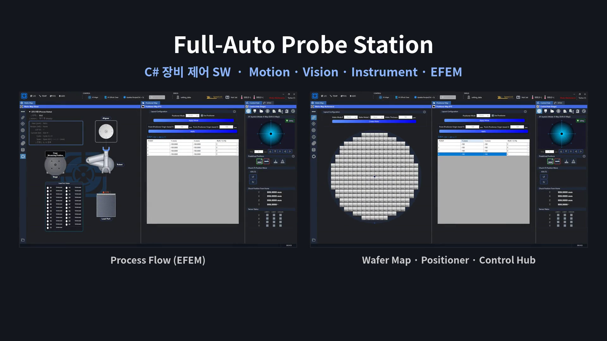
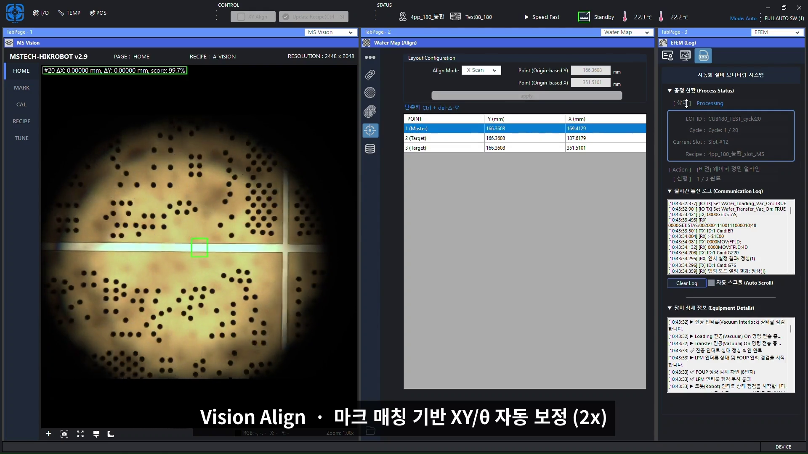
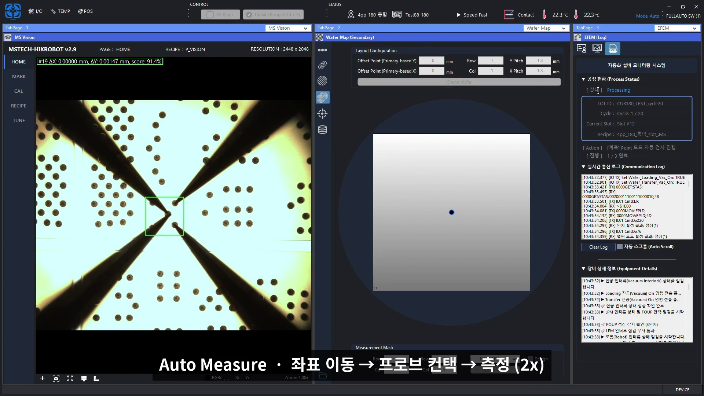
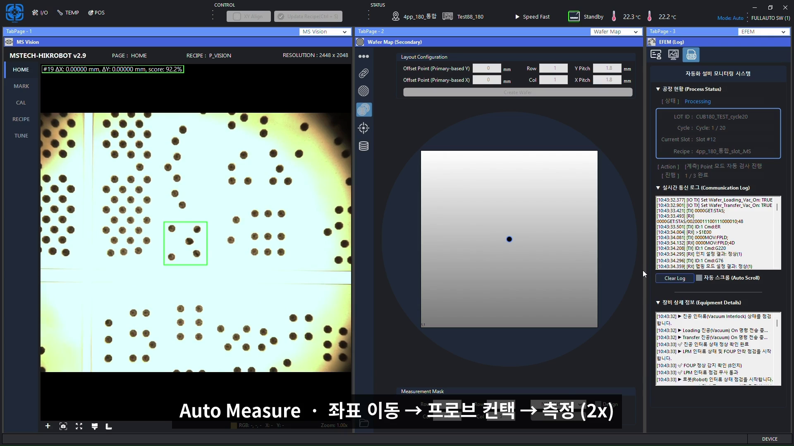

# High/Low Resistance Auto Probe Station

Control software for a **Full-Auto Probe Station** performing automated **high/low resistance measurement** on semiconductor wafers.
C# · WinForms · .NET Framework | MSTECH

## Overview
Equipment control software that fully automates the process from wafer loading, vision alignment, and coordinate positioning to probe contact and measurement.

## Features
- **EFEM** : Automated wafer transfer — LoadPort (FOUP) → Robot → Pre-Align → Stage
- **Motion** : Multi-axis motion control with Ajin AXL and Ezi-SERVO, homing / coordinate systems / positioners
- **Vision** : HIKROBOT camera with mark-matching–based XY/θ auto alignment
- **Auto Measure** : Wafer-map–based positioning → probe contact → high/low resistance measurement
- **Instrument** : VISA/GPIB instrument integration and raw measurement data management
- **Device** : Temperature controller, load cell, OCR (wafer ID), IO/interlock
- **UI** : Control Hub, recipe management/lock, EMO recovery, real-time communication log

## Screenshots
| Vision Align | Auto Measure |
|---|---|
|  |  |

## Architecture
UI (MainForm / ControlHub / EFEM / Wafer Map)
│
Sequence (Auto Run · Resume · Interlock)
│
Device Layer
├─ Motion : Ajin / Ezi-SERVO / Positioner
├─ Robot / LoadPort / Pre-Align
├─ Vision (HIKROBOT)
├─ Instrument (VISA / GPIB)
└─ Temp / LoadCell / OCR / IO

## Tech Stack
C#, WinForms, .NET Framework, OpenCvSharp, Ajin AXL, Ezi-SERVO, HIKROBOT MVS, VISA/GPIB, RS-232C/TCP

## Role
- Period : 2025.10 – 2026.01
- Designed and developed the entire equipment control software
